# 🌐 Awesome HTTP Response Viewer & Inspection Tools 🔍

  

  
  
  
  
  
  

---

## ⚡ Top HTTP Response Viewer & Traffic Inspection Ecosystem 🚀

**Curated List of SaaS Platforms & Open-Source GitHub Projects**  
*Focused on HTTP/HTTPS Traffic Interception, Payload Analysis, HAR Inspection, SSL Decryption & Self-Hosted Debugging Proxies*  
**Last updated: March 2026**

Welcome to the definitive developer directory of **HTTP Response Viewers**, **API Debugging Proxies**, and **Network Traffic Inspectors**. Whether troubleshooting REST, GraphQL, WebSocket, or gRPC payloads, these tools empower engineers to examine server responses, inspect headers and cookies, decrypt SSL/TLS traffic, mock response bodies, and simulate network conditions across browsers, mobile apps, and microservice architectures.

---

## 📑 Table of Contents
- [📊 Sector Overview & Market Dynamics](#-sector-overview--market-dynamics)
- [☁️ SaaS & Hosted Platforms](#️-saas--hosted-platforms)
- [💻 Open-Source GitHub Projects](#-open-source-github-projects)
  - [⭐ Featured Category Leaders](#-featured-category-leaders)
  - [🚀 Additional Powerful Open-Source Tools](#-additional-powerful-open-source-tools)
- [🤝 How to Contribute](#-how-to-contribute)
- [💖 Support & Sponsor](#-support--sponsor)
- [📈 Star History](#-star-history)
- [⚠️ Disclaimer](#️-disclaimer)

---

## 📊 Sector Overview & Market Dynamics

The global **API testing, network debugging, and traffic observability** market is currently estimated at **$1.8B – $2.8B** and is expanding rapidly at an estimated **18% – 23% CAGR**, projected to reach over **$10B** within the next decade. 

This sector exhibits a **moderately fragmented, "winner-take-most" dynamic** at the top developer workspace layer (dominated by platform hubs like Postman and browser-native suites like Chrome DevTools), while remaining **highly fragmented and diversified at the protocol, proxy, and self-hosted interception layer**. Because modern application engineering spans complex polyglot environments—including GraphQL, gRPC, WebSocket streaming, microservice meshes, mobile TLS certificate pinning, and stringent data-sovereignty mandates—no single vendor commands a total monopoly. As a result, powerful open-source utilities (e.g., mitmproxy, Hoppscotch, Bruno, HTTP Toolkit) and specialized desktop proxies (e.g., Charles Proxy, Proxyman) continue to thrive alongside large enterprise testing platforms.

---

## ☁️ SaaS & Hosted Platforms

Below is a breakdown of top commercial SaaS and desktop proxy platforms for HTTP response inspection. Entries are **sorted in descending order by company scale** (market capitalization or private valuation).

| Product | Company Scale (Valuation / Revenue) | Description | Pricing (Starting) | Free Tier / Trial Limits |
|---------|------------------------------------|-------------|-------------------|--------------------------|
| **[Chrome DevTools Network Tab](https://developer.chrome.com/docs/devtools/network/)** | **~$3.5T+ Market Cap** (Alphabet Inc. / Google; FY25 Revenue: $402.8B) | **The zero-install baseline for browser-based response inspection.** Records every HTTP/HTTPS request the browser page makes; click any row to examine **Headers, Preview (formatted JSON/tree view), Response (raw body), Cookies, and Timing breakdown** tabs [citation:11]. Displays **response time, payload size, protocol, and status codes** inline. Copy any request directly as cURL or Fetch for rapid console replay [citation:11]. | Free ($0, built natively into Google Chrome) | Free forever (100% full feature access included with browser, zero limits) |
| **[Postman Response Inspection](https://www.postman.com/)** | **~$5.6B Valuation** (Last round; ~$310M+ ARR baseline) | **The industry-standard API client and testing platform.** Features a dedicated response viewer showing HTTP status codes, latency timings, download sizes, response headers, cookies, and syntax-highlighted bodies (JSON, XML, HTML, Text). Includes automated test assertion scripts and visualizers [citation:2]. | Solo: $9/user/month (billed annually); Team: $19/user/month (billed annually) | Free forever plan: 1 user, 1,000 monitoring calls/month, 50-100 AI credits/month, unlimited collection runs (no team collaboration) |
| **[Fiddler Everywhere](https://www.telerik.com/fiddler)** | **~$1.8B+ Market Cap** (Progress Software; FY25 Revenue: $977.8M) | **Cross-platform HTTPS debugging proxy with collaborative team features.** Provides an intuitive visual Rules builder, request/response mocking, and beta C# scripting hooks. **Fiddler Classic is restricted to non-commercial use only since August 2026**—commercial teams must use Everywhere [citation:6][citation:14]. | Lite: $7/user/month (billed annually) or $10/user/month (billed monthly); Pro: $13/user/month | 10-day free trial with full feature access (1 activation per unique device); no permanent free tier |
| **[Proxyman](https://proxyman.com/)** | **~$5M – $10M Est. Valuation** (Bootstrapped indie by Noah Tran; ~$1M ARR) | **Native macOS, Windows & Linux HTTPS debugging proxy with high performance.** Features SSL/TLS proxying, request/response breakpoints, Map Local/Map Remote, payload diffing, WebSocket inspection, and automated JavaScript scripting rules. | $89 one-time license (Standard single-user with 1 year updates) or $10/seat/month | Free forever for personal use (limited to 1-2 rules per tool e.g. Map Local/Breakpoint, 2 pinned domains); commercial free trial limited to 14 days |
| **[Charles Proxy](https://www.charlesproxy.com/)** | **Bootstrapped Micro-SaaS** (Indie business by Karl von Randow / XK72 Ltd) | **Classic desktop MITM debugging proxy.** Built-in per-host SSL proxying list that decrypts only configured domains while leaving all other traffic in opaque tunnels [citation:14]. Supports throttling, response rewrite, repeat requests, and HAR/W3C logging. | $50 one-time license fee (per single user / machine) | 30-day free evaluation; after trial expires, session limit of 30 minutes per run |

---

## 💻 Open-Source GitHub Projects

Open-source debugging proxies and API response viewers provide data sovereignty, eliminate per-seat licensing costs, and allow programmatic scripting in CI/CD pipelines.

Below entries are **sorted in descending order by GitHub Stars_Count (⭐)**. Every badge links directly to the stargazers page of that repository.

### ⭐ Featured Category Leaders

| Project | GitHub_Stars | Description |
|---------|--------------|-------------|
| **[Hoppscotch](https://github.com/hoppscotch/hoppscotch)** |  | **Open-source API development ecosystem and lightweight Postman alternative.** Runs in browser, desktop, and CLI. Provides an instantaneous response viewer with syntax highlighting, header analysis, real-time WebSocket/SSE/GraphQL viewers, response search, and offline-first storage. **MIT licensed**. |
| **[Bruno](https://github.com/usebruno/bruno)** |  | **Fast and git-friendly open-source API client and response explorer.** Stores collections directly in local folder files using the plain-text Bru markup language. Features comprehensive response inspectors (body, headers, timeline, cookies), automated test assertions, and zero cloud lock-in. **MIT licensed**. |
| **[mitmproxy](https://github.com/mitmproxy/mitmproxy)** |  | **The definitive open-source scriptable MITM proxy for automated traffic interception.** **MIT licensed**, Python. **Three interfaces**: `mitmproxy` (interactive TUI), `mitmweb` (browser web UI), and `mitmdump` (headless for CI/scripts) [citation:14]. **Python addons** receive each flow as a mutable object—log 4xx/5xx responses with headers, tamper with bodies on the fly, or dump flows for replay [citation:14]. Generates custom CA for TLS interception; certificate pinning defeats it unless bypassed [citation:6]. |
| **[Insomnia](https://github.com/Kong/insomnia)** |  | **Leading open-source API design, debugging client, and response inspector.** Maintained by Kong. Deep support for REST, GraphQL, gRPC, and WebSockets. Features pretty-printed response previewers, raw data views, response history timelines, and cookie management. **Apache-2.0 licensed**. |
| **[Mockoon](https://github.com/mockoon/mockoon)** |  | **The easiest and quickest way to design, mock, and inspect local HTTP APIs.** Desktop GUI application with proxy mode that records outgoing requests and incoming responses, logs payloads, and simulates mock responses with custom status codes and latency. **MIT licensed**. |
| **[Chucker](https://github.com/ChuckerTeam/chucker)** |  | **In-app HTTP(S) inspector for Android & OkHttp applications.** Like Charles Proxy directly inside your mobile device: intercepts network calls, records request/response payloads, and displays them via a native on-device notification and inspection UI. **Apache-2.0 licensed**. |
| **[HTTP Toolkit](https://github.com/httptoolkit/httptoolkit)** |  | **Beautiful, open-source intercepting proxy and HTTP debugging tool** for Windows, macOS, and Linux. Intercepts HTTP(S) with zero configuration for browsers, Node.js, Python, Ruby, Docker, and Android. Features live payload inspection, breakpoint editing, mock responses, and WebSocket decoding. |
| **[Proxify](https://github.com/projectdiscovery/proxify)** |  | **Swiss Army knife proxy tool for HTTP/HTTPS traffic capture, manipulation, and replay on Go.** Built by ProjectDiscovery for security testing and bug hunting. Dumps all captured traffic to disk in readable formats, decodes responses, and integrates directly with security automation pipelines. **MIT licensed**. |
| **[Restfox](https://github.com/flawiddsouza/Restfox)** |  | **Offline-first, minimalistic HTTP/WebSocket/GraphQL client** for web and desktop. Open-source Postman alternative featuring environment variables, formatted response viewer, response history, and plugin ecosystem. Available via web app, desktop, and Docker [citation:10]. **MIT licensed**. |
| **[Rockxy](https://github.com/RockxyApp/Rockxy)** |  | **Open-source native macOS HTTP debugging proxy.** Intercepts HTTPS traffic, inspects APIs, mocks responses, and debugs **WebSocket & GraphQL** payloads with a native Swift interface [citation:1]. Built for developers seeking a native Mac alternative to Charles. |
| **[httpmon](https://github.com/kostyay/httpmon)** |  | **Terminal-native HTTP/HTTPS debugging proxy with Bubble Tea TUI.** Built in Go with MITM interception, ring buffer storage, tree views by host/process, vim-style navigation keys, and rich syntax-highlighted response viewers. **MIT licensed**. |
| **[Bema](https://github.com/BahaaAlazawwy/bema-Lightweight-API-Testing-Tool)** |  | **Ultra-lightweight browser-based API client with focused response viewer.** ~5 MB footprint (vs Postman's ~250 MB) [citation:2]. Features syntax-highlighted JSON with line numbers, **color-coded HTTP status badges** (2xx green, 4xx amber, 5xx red), inline response latency and size metrics, and multi-method endpoint discovery [citation:2]. **MIT licensed**. |
| **[hartool](https://github.com/9072997/hartool)** |  | **CLI tool for inspecting HAR (HTTP Archive) files with AI-agent integration.** **GNU GPL**. Commands include `list`, `exchange` (full request + response), `resp-body` (pretty-printed), and regex search across headers and bodies [citation:4]. Includes an **MCP server** (`hartool mcp`) enabling LLM agents to analyze captured network sessions [citation:4]. |
| **[OpenPost](https://github.com/azlanabdulla/OpenPost)** |  | **Open-source desktop API client and response viewer.** Built with React, TypeScript, Tauri, and Rust with local-first storage. Inspects status codes, response headers, cookies, and formatted bodies [citation:7]. |

---

### 🚀 Additional Powerful Open-Source Tools

- 🔧 **[mitmweb](https://mitmproxy.org/)**: The official web interface bundled with `mitmproxy` that provides a browser-based, point-and-click UI for inspecting live captured streams.
- 📱 **[ProxyMaxx](https://github.com/AgiMaulana/ProxyMaxx)**: A free, lightweight macOS proxy utility to intercept, decrypt, and inspect traffic, view raw/hex/pretty formats, and export to cURL.
- 🛡️ **[ZAP (Zed Attack Proxy)](https://github.com/zaproxy/zaproxy)**: World's most widely used open-source web application security scanner and intercepting proxy for in-depth HTTP request/response vulnerability inspection.

---

## 🤝 How to Contribute

Contributions are welcome and appreciated! To add or update a tool:

1. 🍴 Fork the repository.
2. 📝 Update `README.md` following the established table structure.
3. 🔗 Include official product name, link, concise factual description, pricing/scale details, and accurate GitHub Stars_Badges.
4. 🚀 Submit a Pull Request with a clear description of your addition.

---

## 💖 Support & Sponsor

If you found this directory helpful for your development workflow, debugging sessions, or team evaluations, please consider supporting the project:

- ⭐ **Star this repository** to help other developers discover it!
- 🍴 **Fork and share** it with your developer community, colleagues, and network.
- ☕ **Buy me a coffee**: You can sponsor ongoing maintenance and updates directly via the [GitHub Sponsors Dashboard](https://github.com/sponsors/ishandutta2007). Your support is deeply appreciated!

---

## 📈 Star History

---

## ⚠️ Disclaimer

- This is an independent, community-curated directory intended for research, software development, and quality assurance purposes; it is not an endorsement.
- HTTP inspection tools capture traffic that may include authentication tokens, session cookies, API secrets, and sensitive user payloads. **Only inspect traffic and endpoints you own or have explicit written permission to test.**
- Always uninstall or deactivate local root Certificate Authority (CA) certificates from test devices and browsers when debugging sessions conclude. Never share unredacted flow or HAR files carelessly [citation:6].
- **Choosing the right tool:**
  - **Browser background inspection:** Use **Chrome DevTools** (zero install, native browser integration) [citation:6].
  - **Mobile app & system-wide traffic capture:** Use **mitmproxy**, **HTTP Toolkit**, **Proxyman**, or **Charles Proxy** [citation:14].
  - **Scripted CI/CD test automation:** Use **mitmproxy** (`mitmdump` + Python hooks) [citation:14] or **Proxify**.
  - **API exploration & response viewing:** Use **Hoppscotch**, **Bruno**, **Insomnia**, or **Bema** [citation:2].
  - **Post-mortem HAR analysis:** Use **hartool** [citation:4].

---

  <b>Built with ❤️ for developers, QA engineers, security researchers, and DevOps professionals.</b> 
  Making HTTP response viewing and traffic inspection open, scriptable, and transparent.

